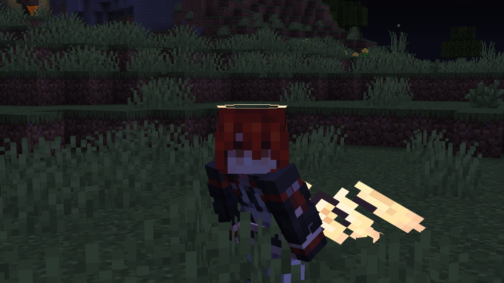
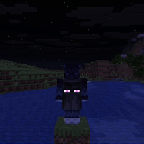
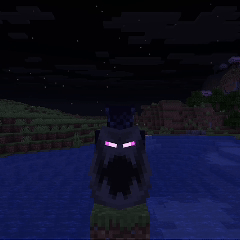
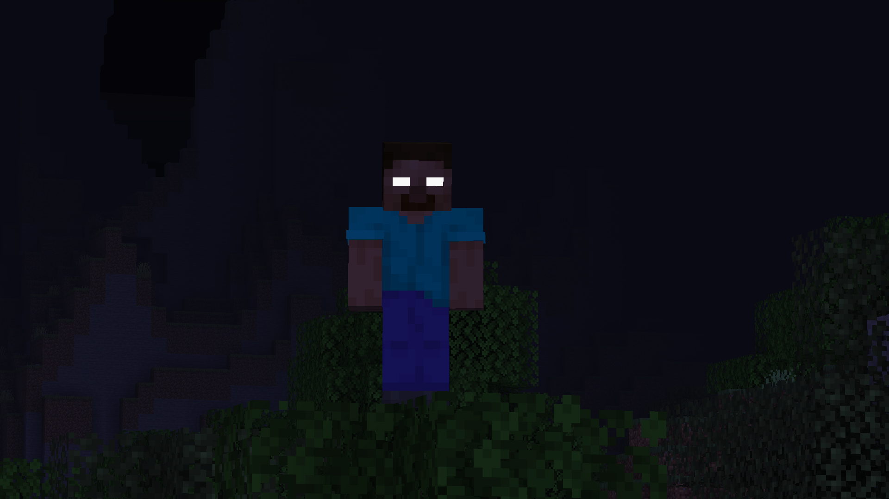

  

<h3 align="center">
  A versatile yet minimal player customization mod.
</h3>

---

## What is Skinmatics?
Skinmatics is a versatile yet minimal player customization mod.
Skinmatics adds cosmetic features to your player character without
replacing the entire model.

    

    Utilitary is a required dependency for Skinmatics

### What does Skinmatics provide?
Skinmatics allow the player character to customize their character, especially the textures.

Skinmatics mainly adds dynamic eyes to your character
so your character appears more lively and natural.

Additionally, Skinmatics adds a bunch of emissive (glowing) features such as

#### Skin

Extras: Minecraft account skin* can now be transparent

*Skinmatics does not sync your skin to your Minecraft account, you are free to customize.
Currently, other players can't see your customization.

#### Elytra

#### Eyes

There will be more customization features in the near future

---

## How do I use Skinmatics?

---

## What is the goal of Skinmatics?
Skinmatics aims to be not just a regular cosmetic mod,
but allowing players to have freedom to express themselves
through their Minecraft character,
making the characters to be more lively than ever before.

### We have design rules

We have enforced our design rules to be as vanilla-as-possible, meaning:
- We will not add complex 3D-geometry models
- We will not fully replace vanilla models
- We will not add custom animations
- We will not add something that is high-resolution in texture

These design rule can be ignored if we separate the contents as an addon to Skinmatics.

### What will be added to Skinmatics?
Our plans for Skinmatics keep adding as times goes on,
we may also get community ideas that we liked and fit with Skinmatics design-rule to add it in the future.

### Will Skinmatics be ported to Forge / NeoForge / other loaders?
No, Skinmatics have no development plan for porting to other mod loaders as of now.

### Will Skinmatics be backported to Minecraft version below 26.1?
No, Skinmatics have no development plan for backporting the mod as of now.
Even though the mod first developed at 1.21.11,
we figured 26.1 and above is the optimal version to develop Skinmatics.

Minecraft prior to 26.1 is inconsistent with their sematic version,
making it difficult to differentiate changes to their code,
we might encounter essential code that never exists in older version.

## Can I contribute to Skinmatics?
Skinmatics currently not accepting any contributors,
the codebase is not stable and is prone to major api changes,
this might slow down contributors to make changes and/or updates.

The code is licensed under MIT License,
meanwhile the assets are licensed under All Rights Reserved.